<div align="center">

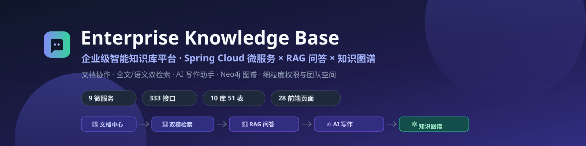


**基于 AI 技术的下一代企业知识管理平台** —— 文档协作 · 全文/语义双检索 · RAG 知识问答 · AI 写作 · 知识图谱

[架构总览](#-系统架构) · [功能矩阵](#-核心功能) · [AI 能力](#-ai-能力) · [代码导览](#-面试官代码导览) · [快速启动](#-快速启动)

</div>

---

## 📖 项目定位

一套完整的**企业级智能知识库**：以 Spring Cloud 微服务为骨架，围绕「文档 → 检索 → 问答 → 图谱」知识链路构建，
覆盖团队知识沉淀、细粒度权限、审核协作、AI 辅助写作与 RAG 问答的完整闭环。

| 规模指标 | 数值 | 规模指标 | 数值 |
|---|---|---|---|
| 后端微服务 | **9 个**（+1 公共模块） | 后端代码 | **538** 个 Java 文件 |
| REST 接口 | **333** 个（39 个 Controller） | 数据库 | **10 个业务库 / 51 张表** |
| 前端页面 | **28** 个页面 / 40 条路由 | 前端技术 | React 18 + TypeScript + Ant Design 5 |

> ⚠️ 因安全考虑，本仓库**不含数据库脚本与真实密钥**（配置已全部环境变量化），无法开箱即跑；
> 定位为**源码阅读与技术评审**。如需完整体验请联系作者。

## 🖼 系统架构

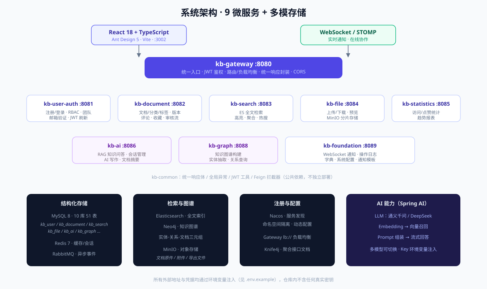

<details>
<summary><b>服务端口与职责一览</b>（点击展开）</summary>

| 服务 | 端口 | 职责 |
|---|---|---|
| kb-gateway | 8080 | 统一入口 · JWT 鉴权 · 路由/负载均衡 · 统一响应封装 |
| kb-user-auth | 8081 | 注册/登录 · RBAC 权限 · 团队空间 · 邮箱验证 · Token 刷新 |
| kb-document | 8082 | 文档/分类/标签 CRUD · 版本管理 · 评论收藏 · 审核流 |
| kb-search | 8083 | Elasticsearch 全文检索 · 高亮 · 热搜 · 搜索历史 |
| kb-file | 8084 | 文件上传下载 · 在线预览 · MinIO 分片存储 |
| kb-statistics | 8085 | 浏览/点赞统计 · 趋势报表 |
| kb-ai | 8086 | RAG 知识问答 · AI 写作 · 文档摘要 · 会话管理 |
| kb-graph | 8088 | Neo4j 知识图谱 · 实体抽取 · 关系查询 |
| kb-foundation | 8089 | WebSocket 通知 · 操作日志 · 字典 · 系统配置 |
| kb-common | — | 统一响应体 / 全局异常 / JWT 工具 / Feign 拦截器 |

</details>

## 🎬 界面预览

<table>
  <tr>
    <td width="50%">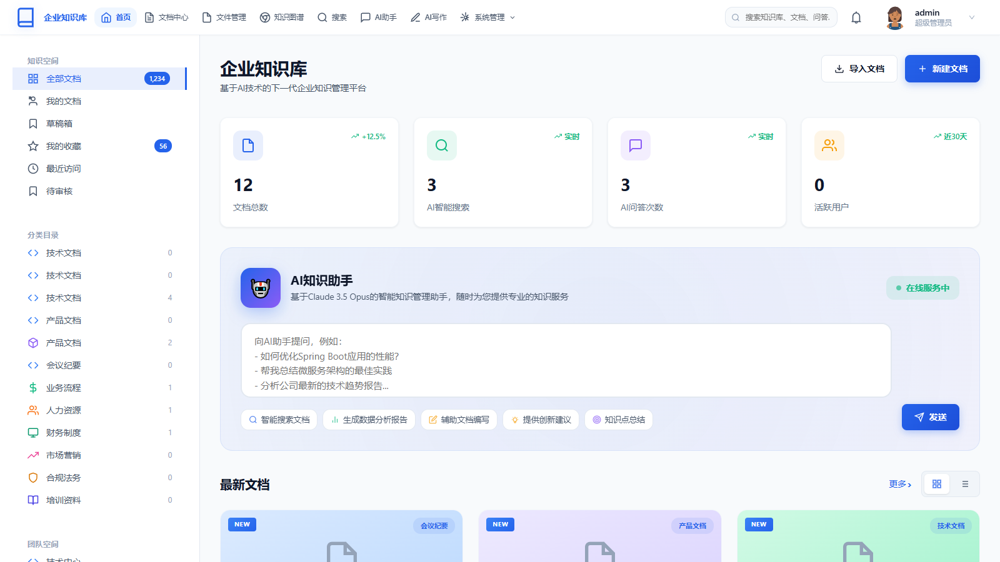<br/><sub><b>工作台</b> — 数据概览 · AI 知识助手 · 最新文档</sub></td>
    <td width="50%">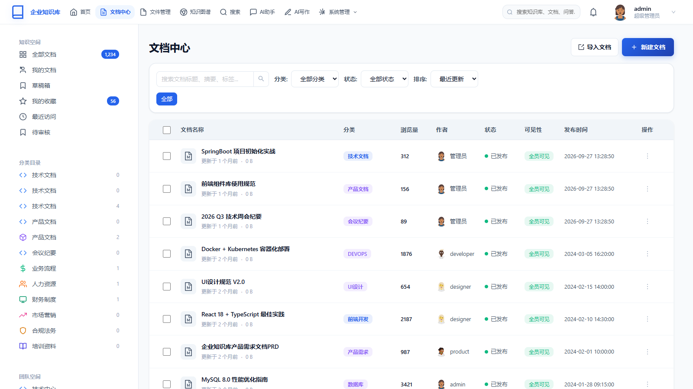<br/><sub><b>文档中心</b> — 分类树 · 多维筛选 · 批量操作</sub></td>
  </tr>
  <tr>
    <td>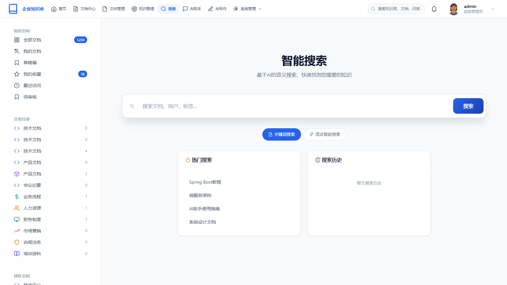<br/><sub><b>智能搜索</b> — 关键词/混合语义双模式</sub></td>
    <td>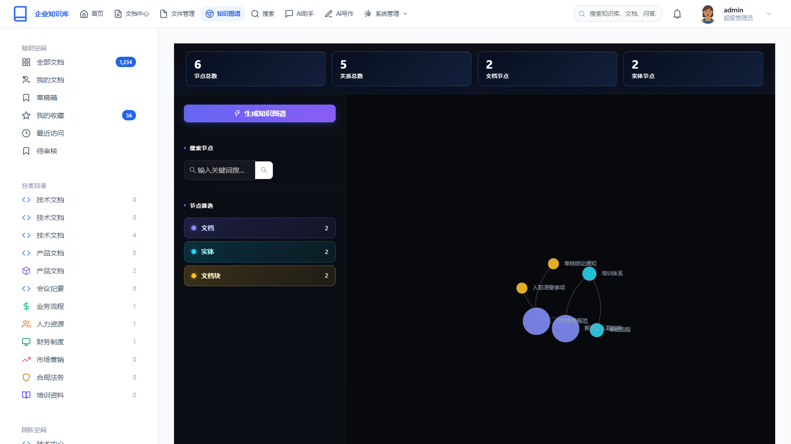<br/><sub><b>知识图谱</b> — 节点/关系统计 · 力导向图</sub></td>
  </tr>
  <tr>
    <td>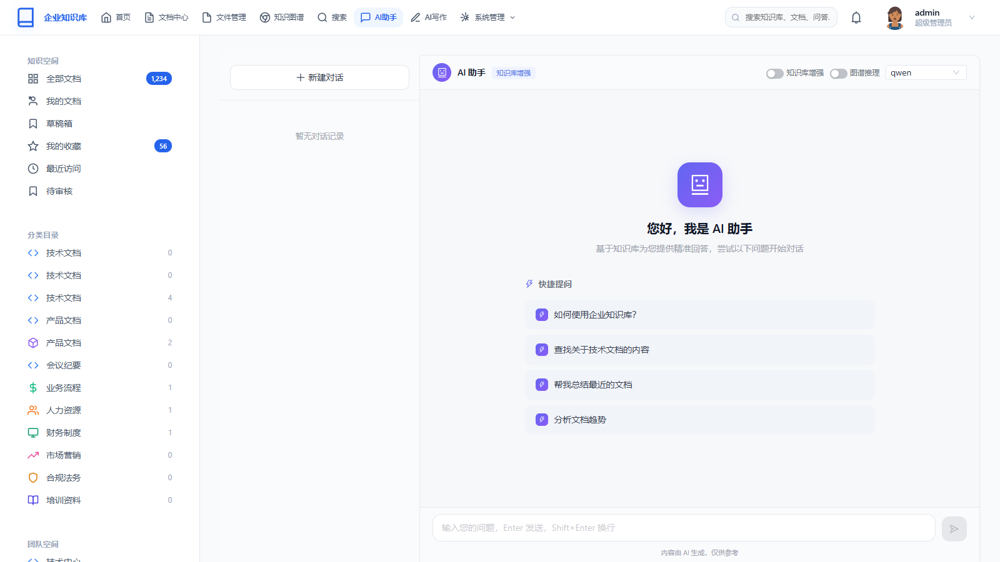<br/><sub><b>AI 助手</b> — 多模型切换 · 知识库增强</sub></td>
    <td>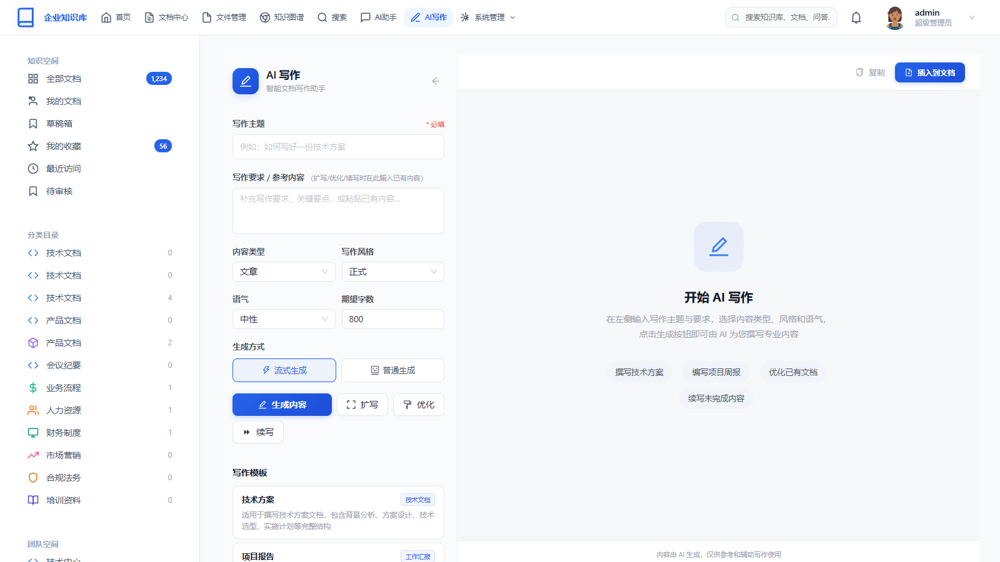<br/><sub><b>AI 写作</b> — 主题/风格/语气 · 流式生成 · 一键插入</sub></td>
  </tr>
  <tr>
    <td>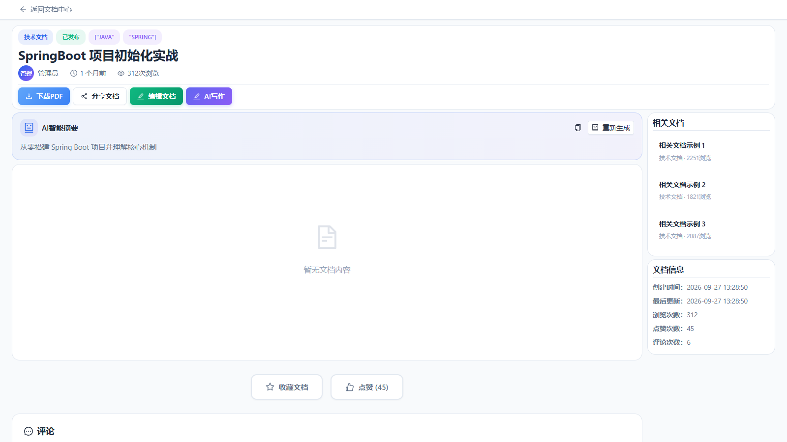<br/><sub><b>文档详情</b> — AI 摘要 · 相关推荐 · 评论点赞</sub></td>
    <td>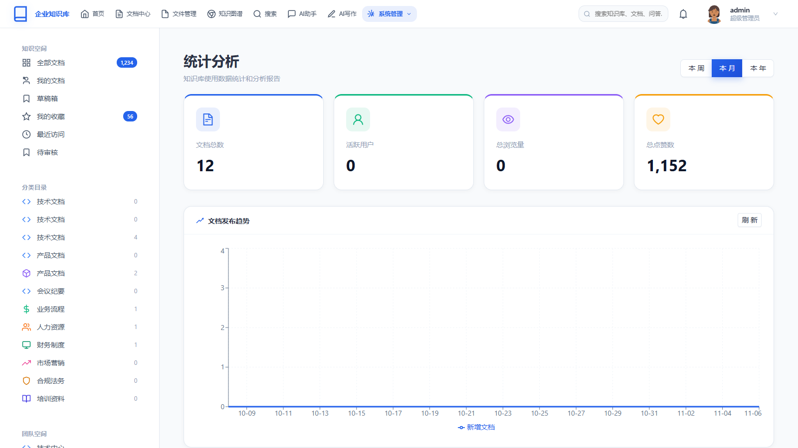<br/><sub><b>统计分析</b> — 趋势图表 · 多维指标</sub></td>
  </tr>
</table>

## ✨ 核心功能

### 📝 知识沉淀
- **文档全生命周期**：在线编辑（Markdown）、导入导出（Word/PDF/Excel）、草稿自动保存与历史版本
- **组织化结构**：多级分类 + 标签体系 + 团队空间，支持会员可见性（全员/会员/私有）
- **协作治理**：文档审核工作流、评论互动、收藏点赞、访问权限管控

### 🔎 双模检索
- **Elasticsearch 全文检索**：分词、高亮、聚合、热门搜索、搜索历史
- **语义检索**：Embedding 向量化召回，与关键词检索融合排序

### 🤖 AI 能力

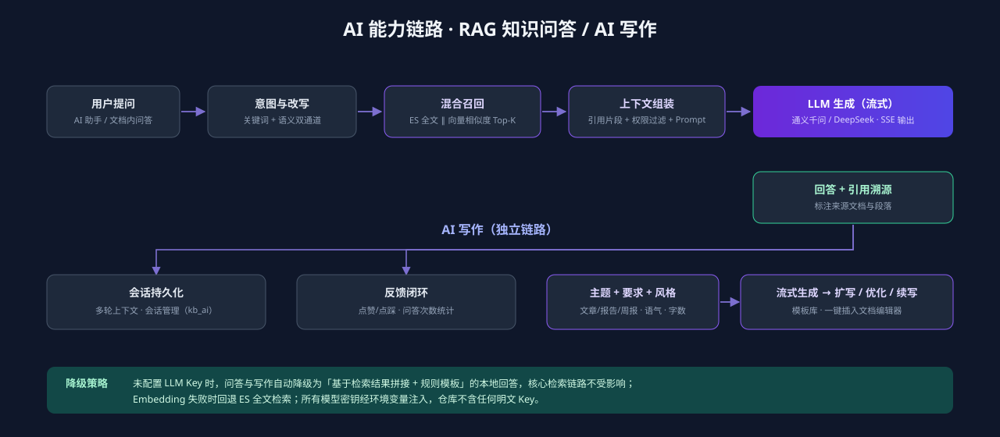

- **RAG 知识问答**：ES 全文 ∥ 向量召回双通道 → 权限过滤 → Prompt 组装 → 流式回答 + 引用溯源
- **AI 写作**：主题/类型/风格/语气/字数可控生成，支持扩写、优化、续写，一键插入文档编辑器
- **文档智能摘要**：上传/发布后自动生成摘要
- **多模型路由**：通义千问 / DeepSeek 可切换，Key 全部环境变量注入，未配置时自动降级为本地规则回答

### 🕸 知识图谱
- Neo4j 存储「文档 - 实体 - 关系」三元组，力导向图可视化，支持按类型过滤与关键词检索节点

### 🔐 安全与治理
- JWT 双 Token（Access 2h / Refresh）+ 验证码防爆破
- RBAC 角色权限 + 数据行级可见性 + 操作日志审计
- 网关统一响应封装、全局异常处理、CORS 治理

## 🏗 工程亮点

| # | 亮点 | 说明 |
|---|---|---|
| 1 | **按域拆库** | 10 个业务库（kb_user / kb_document / kb_search …），服务间不跨库 join，走 Feign 聚合 |
| 2 | **网关统一治理** | 统一响应体包装 Filter、全局异常映射、JWT 校验前移到边缘 |
| 3 | **异步解耦** | RabbitMQ 承载文件处理、通知、统计等异步事件 |
| 4 | **实时通道** | WebSocket/STOMP 推送通知与协作事件，前端 STOMP 客户端自动重连 |
| 5 | **可观测** | 操作日志 AOP 落库、Druid 监控、Knife4j 聚合文档（每服务 /doc.html） |
| 6 | **配置零明文** | 所有中间件地址与凭据 `${ENV:default}` 注入，配套 `.env.example` 一键交付 |

## 🧭 面试官代码导览

按这条路径读，10 分钟看完全部亮点：

| 步骤 | 入口文件 | 看什么 |
|---|---|---|
| ① 鉴权链路 | `backend/kb-gateway/…/filter/` | JWT 校验、统一响应封装 Filter、路由配置 |
| ② 认证服务 | `backend/kb-user-auth/…/controller/AuthController.java` | 登录/注册/刷新/邮箱验证，RBAC 设计 |
| ③ 文档域核心 | `backend/kb-document/…/service/impl/` | 文档 CRUD、版本、审核流、Feign 跨服务聚合 |
| ④ RAG 问答 | `backend/kb-ai/…/service/`（检索 + LLM 编排） | 双通道召回、Prompt 组装、SSE 流式、降级策略 |
| ⑤ 前端架构 | `frontend/src/services/` + `src/stores/` | Axios 拦截与 Token 刷新、Zustand 状态、路由守卫 |

<details>
<summary><b>技术栈明细</b>（点击展开）</summary>

| 层 | 技术 | 版本 |
|---|---|---|
| 运行环境 | Java | 21 |
| 核心框架 | Spring Boot | 3.2.0 |
| 微服务 | Spring Cloud / Alibaba Cloud | 2023.0.0 / 2023.0.1.0 |
| ORM | MyBatis-Plus | 3.5.8 |
| 接口文档 | Knife4j (OpenAPI 3) | 4.3.0 |
| 工具库 | Hutool | 5.8.24 |
| 存储 | MySQL 8 / Redis 7 / MinIO / Neo4j 5 / Elasticsearch 8 | — |
| 消息 | RabbitMQ | — |
| AI | Spring AI（通义千问 / DeepSeek） | — |
| 前端 | React 18 + TypeScript + Vite + Ant Design 5 + Zustand + ECharts | — |

</details>

## 🚀 快速启动

<details>
<summary><b>环境要求与启动步骤</b>（点击展开）</summary>

```bash
# 1. 准备中间件（可用 Docker）
#    MySQL 8 / Redis 7 / Nacos 2.x / Elasticsearch 8 / Neo4j 5 / MinIO / RabbitMQ

# 2. 配置环境变量
cp .env.example .env   # 填入各中间件地址与凭据

# 3. 初始化数据库（10 个 kb_* 库，脚本不随仓库提供）

# 4. 启动后端（9 个服务，建议顺序：user-auth → document → search → file →
#    statistics → ai → graph → foundation → gateway）
cd backend
mvn -pl kb-user-auth -am spring-boot:run

# 5. 启动前端
cd frontend
npm install
npm run dev        # http://localhost:3002
```

</details>

## 📂 仓库结构

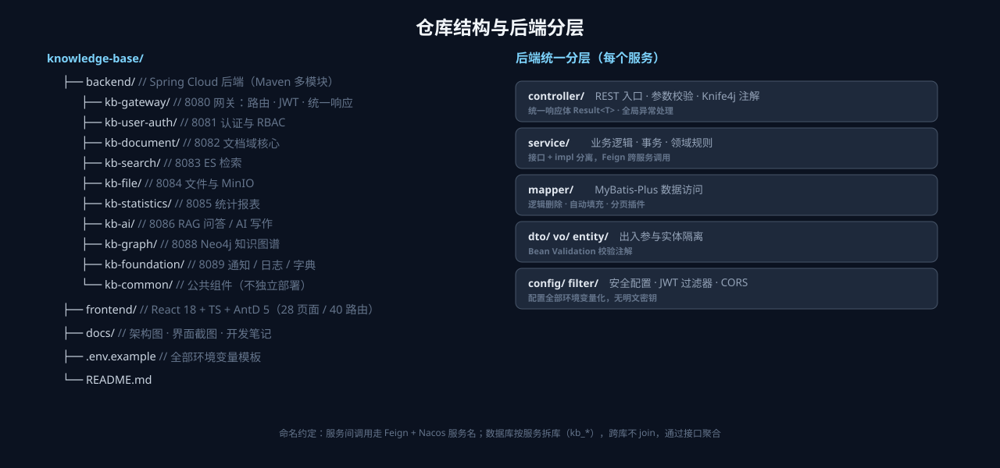

## 📄 公开范围说明

| 内容 | 状态 |
|---|---|
| 后端 / 前端全部源码 | ✅ 提供 |
| 数据库建表与初始化脚本 | ❌ 不提供（含业务数据） |
| 中间件地址与凭据 | ❌ 已全部替换为 `${ENV:default}` 占位（模板见 `.env.example`） |
| LLM API Key | ❌ 不含任何明文 Key |

## 📄 License

**保留所有权利** — 允许学习、面试评审与思路引用；禁止商用、二次分发与打包上传。详见 [LICENSE](LICENSE)。
