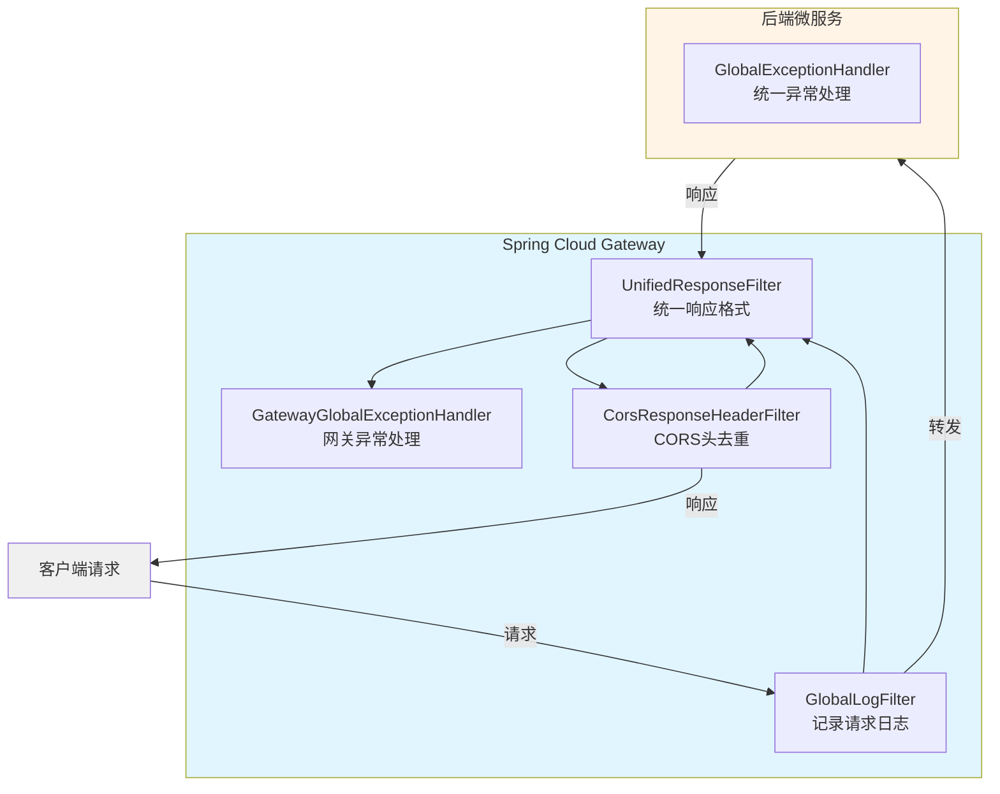
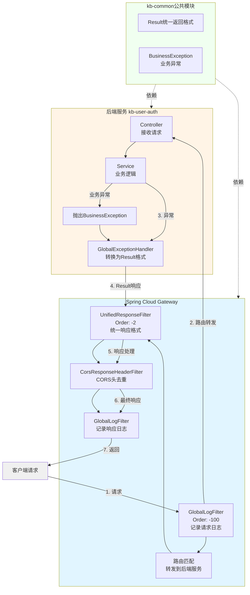
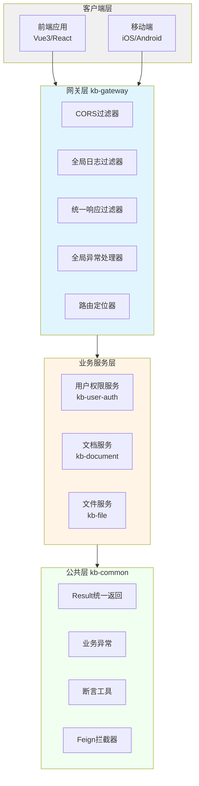
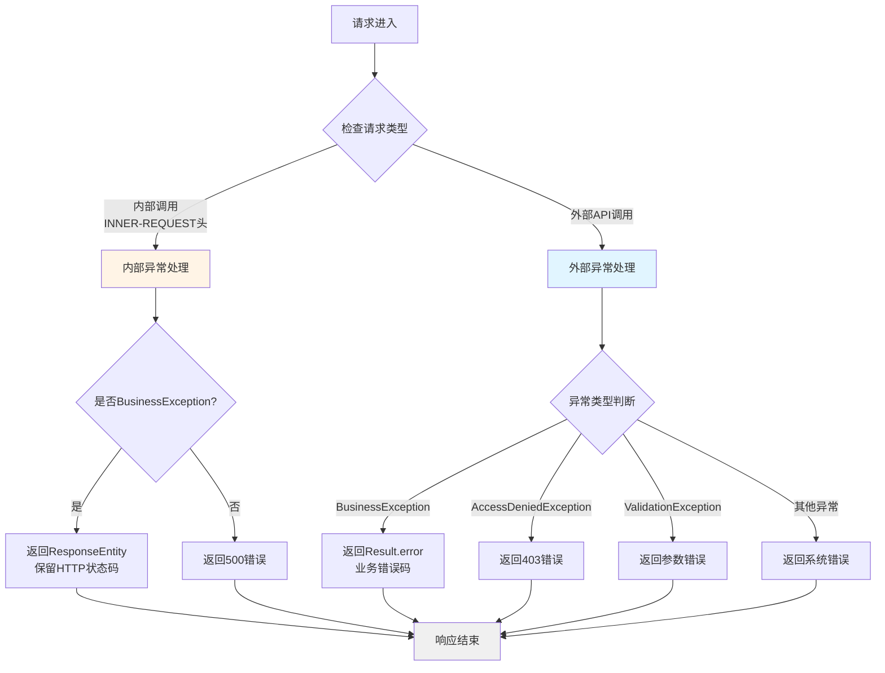
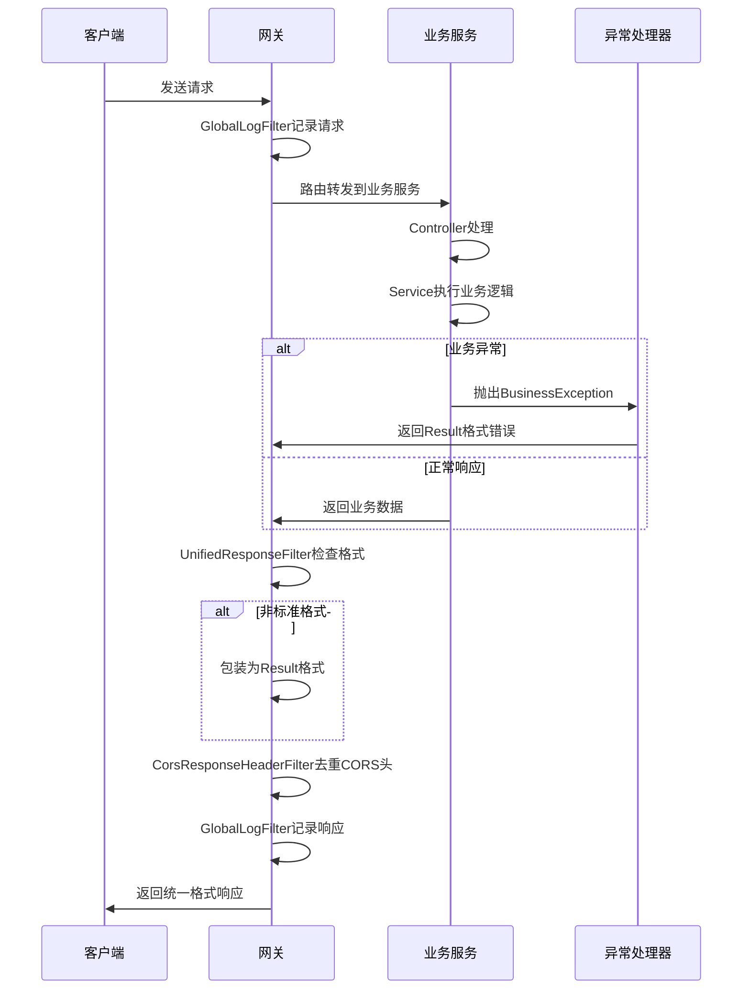

# 增加网关服务对接口返回值和异常做统一封装 - 架构图

本文档包含文章中所有架构图的Mermaid语法，可在draw.io中导入使用。

## 1. 技术架构图（API调用流程）



## 2. 完整调用链路图



## 3. 系统分层架构图



## 4. 异常处理流程图



## 5. 响应处理流程图



## 在draw.io中使用这些图

### 方法一：使用Mermaid插件
1. 打开draw.io
2. 选择 `Arrange` → `Insert` → `Advanced` → `Mermaid`
3. 将上面的Mermaid代码粘贴到对话框中
4. 点击插入

### 方法二：在线转换
1. 访问 https://mermaid.live/
2. 将代码粘贴到编辑器中
3. 导出为SVG/PNG
4. 在draw.io中导入图片

### 方法三：命令行生成
```bash
# 安装mermaid-cli
npm install -g @mermaid-js/mermaid-cli

# 生成图片
mmdc -i diagrams.md -o architecture.png
```

## 图表说明

- **技术架构图**：展示API调用的整体流程和技术栈
- **完整调用链路图**：详细展示从客户端到响应的完整链路
- **系统分层架构图**：展示系统的分层结构和各层之间的关系
- **异常处理流程图**：展示不同类型异常的处理流程
- **响应处理流程图**：以时序图形式展示请求响应的完整过程
